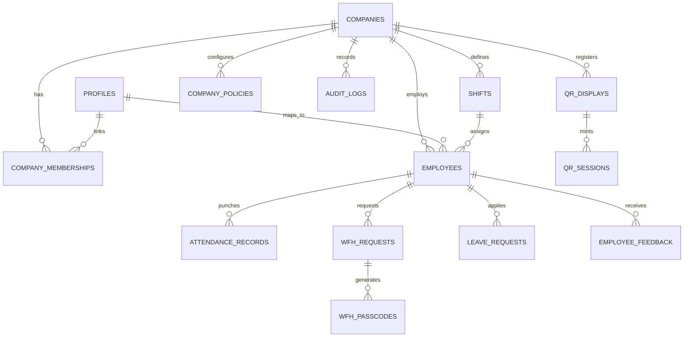

# VorldX Backend Architecture & Database Engine

This directory contains the complete backend infrastructure for the **VorldX Multi-Company Attendance System**, built on **Supabase (PostgreSQL 15)**, **Row Level Security (RLS)**, **Deno Edge Functions**, and **pg_cron** background workers.

---

## Architecture Overview

```
+-----------------------------------------------------------------------------------------+
|                                  PostgreSQL 15 Engine                                   |
|                                                                                         |
|  +-----------------------------------------------------------------------------------+  |
|  |                             Row Level Security (RLS)                              |  |
|  |     Every table enforces tenant isolation via `company_id = auth.company_id()`    |  |
|  +-----------------------------------------------------------------------------------+  |
|                                           |                                             |
|          +--------------------------------+--------------------------------+            |
|          |                                |                                |            |
|          v                                v                                v            |
|  +----------------+              +------------------+             +------------------+  |
|  | Core & Tenants |              |   Attendance     |             |  Requests & Feed |  |
|  | - companies    |              | - attendance_rec |             | - wfh_requests   |  |
|  | - profiles     |              | - qr_displays    |             | - wfh_passcodes  |  |
|  | - memberships  |              | - qr_sessions    |             | - leave_requests |  |
|  | - shifts       |              | - auto_absents   |             | - feedback       |  |
|  | - employees    |              | - audit_logs     |             | - policies       |  |
|  +----------------+              +------------------+             +------------------+  |
|                                           ^                                             |
|                                           | Privileged SECURITY DEFINER                 |
|  +-----------------------------------------------------------------------------------+  |
|  |                               15 Deno Edge Functions                              |  |
|  |   - Cryptographic QR token generation (18s TTL + SHA-256 HMAC)                    |  |
|  |   - Dual-use WFH passcode issuance (SHA-256 hashed)                               |  |
|  |   - Automated absence detection daemon via `pg_cron`                              |  |
|  |   - Segregation of duties validation (no self-approval)                           |  |
|  +-----------------------------------------------------------------------------------+  |
+-----------------------------------------------------------------------------------------+
```

---

## 1. Entity-Relationship Data Model

The schema comprises 14 relational tables scoped strictly by `company_id`:



### Table Breakdown

| Table | Purpose | Security / Key Constraints |
| :--- | :--- | :--- |
| `companies` | Multi-tenant company container. | Unique `slug`, company-scoped timezone. |
| `profiles` | User biographical profile. | 1-to-1 with `auth.users`, triggers `handle_updated_at()`. |
| `company_memberships` | Role mapping (`admin`, `hr`, `employee`). | Composite PK `(company_id, user_id)`, active status. |
| `shifts` | Work shift schedules & rules. | `start_time`, `end_time`, `grace_period_minutes`, `working_days` array. |
| `employees` | Company staff directory. | Unique `(company_id, employee_code)`, references `shift_id`. |
| `attendance_records` | Check-in / check-out log. | Unique `(employee_id, date)`. Mutual exclusion: Office vs WFH. |
| `wfh_requests` | Remote work application. | Cutoff guard (`shift_start - 120m`). Approval segregation. |
| `wfh_passcodes` | 6-digit hashed remote punch passcode. | Passcodes stored as SHA-256 hashes only. Max 2 uses. |
| `leave_requests` | Formal leave applications. | Multi-day `start_date` to `end_date`, status tracking. |
| `qr_displays` | Physical office lobby screens. | Hardware-bound `device_secret_hash`, heartbeat timestamps. |
| `qr_sessions` | 18-second rolling dynamic QR sessions. | Single-use 32-byte cryptographic tokens with server-enforced expiry. |
| `employee_feedback` | Structured 0–10 performance reviews. | 5 criteria integer scores, reviewer comments. |
| `company_policies` | Global company attendance rules. | Enforces cutoff times and grace periods. |
| `audit_logs` | Immutable audit trail. | Append-only record of all administrative corrections and overrides. |

---

## 2. Row Level Security (RLS) Strategy

Every table has RLS enabled (`ALTER TABLE ... ENABLE ROW LEVEL SECURITY`). Zero tenant data is accessible without active authentication and verified membership.

1. **Tenant Isolation**:
   ```sql
   CREATE POLICY "Tenant isolation" ON public.employees
     FOR ALL TO authenticated
     USING (company_id IN (
       SELECT company_id FROM public.company_memberships
       WHERE user_id = auth.uid() AND status = 'active'
     ));
   ```
2. **Role Segregation**:
   - `admin`: Full administrative control across the company tenant.
   - `hr`: Manages employees, reviews employee requests, scans kiosk attendance. Cannot edit global company policies.
   - `employee`: Read-only access to company announcements; access strictly limited to own attendance, passcodes, and requests (`auth.uid() = user_id`).
3. **Privileged Function Bypass**:
   Sensitive write operations (attendance punching, passcode verification, token minting) are routed through `SECURITY DEFINER` Edge Functions and SQL stored procedures, eliminating client-side privilege manipulation.

---

## 3. 15 Deno Edge Functions

Located in [`supabase/functions/`](file:///c:/Users/safal/OneDrive/Desktop/VorldX-Attendance-System/supabase/functions):

1. **`register-company`**: Bootstraps the company tenant, profiles, memberships, default Day Shift (`09:00–18:00`, 10 min grace), and first Admin.
2. **`create-hr`**: Securely provisions HR Executive accounts.
3. **`create-employee`**: Enrolls new employees and assigns shifts.
4. **`remove-employee`**: Revokes access and invalidates active sessions.
5. **`issue-office-qr`**: Verifies the physical kiosk's hardware device secret, mints a signed 32-byte rolling token (valid for 18 seconds), and rate-limits to 1 mint per 5 seconds per screen.
6. **`process-office-attendance`**: Validates scanned QR token, calculates on-time vs late status against shift + grace period in company timezone, and records check-in or check-out.
7. **`generate-wfh-passcode`**: Issues a 6-digit cryptographically hashed PIN with a 2-use limit expiring at shift end.
8. **`mark-wfh-attendance`**: Validates the passcode against its SHA-256 hash and records remote check-in/out.
9. **`submit-wfh-request`**: Validates that WFH is submitted at least 120 minutes prior to shift start in the company's timezone.
10. **`review-wfh-request`**: Enforces strict segregation of duties (HR approves Employee, Admin approves HR, self-approval rejected).
11. **`submit-leave-request`**: Submits business-day leave applications.
12. **`review-leave-request`**: Approves or rejects leave applications.
13. **`admin-correct-attendance`**: Enables administrative punch correction with mandatory audit reason logging.
14. **`submit-feedback-review`**: Validates and stores 0–10 evaluation scores.
15. **`_shared/guards.ts`**: Shared TypeScript security assertions, CORS headers, and timezone helpers.

---

## 4. Anti-Tampering & Security Mechanisms

- **Dynamic Rolling QR (18s TTL)**:
  Office QR codes rotate every 18 seconds. Expiration is strictly evaluated server-side using PostgreSQL timestamps (`now() < expires_at`), preventing photo-sharing or screen capture replay attacks.
- **Hardware-Bound Kiosks**:
  A kiosk URL (`/display/<uuid>`) alone is not sufficient to mint tokens. The display machine must possess an installation device secret stored in local storage, whose SHA-256 hash is verified by the backend. Leaked URLs cannot be used from home.
- **Mutual Exclusivity**:
  Database constraints prevent an employee from registering both an Office punch and a WFH punch on the same calendar day.
- **Automated Absence Detection Daemon (`011a_auto_absent.sql`)**:
  A PostgreSQL background daemon runs via `pg_cron` every 5 minutes. If an active employee has no check-in recorded after their shift end time (+ grace) on a scheduled working day, the engine automatically marks them as `absent` (`source = 'auto'`). Approved leave automatically suppresses the absence.

---

## 5. Migrations & Version History

Database changes are tracked via 17 sequential SQL migrations in [`supabase/migrations/`](file:///c:/Users/safal/OneDrive/Desktop/VorldX-Attendance-System/supabase/migrations):

```
001a_core.sql                     -> Companies, profiles, memberships, shifts, employees
001b_attendance_wfh_qr.sql        -> Attendance records, WFH requests, QR displays, sessions
001c_feedback_audit_rls.sql       -> Feedback, audit logs, and core RLS policies
002a_business_qr.sql              -> QR business rules and validation procedures
002c_wfh.sql                      -> WFH passcode management and cutoff checks
002e_feedback_correction.sql      -> Attendance correction RPC and feedback constraints
003a_leave.sql                    -> Leave request management and status triggers
003b_guards.sql                   -> Helper functions and security definers
005b_role_map.sql                 -> Role mapping refinements
006a_security_hardening.sql       -> Deep RLS tightening and token hashing
006b_qr_device_secret.sql         -> Device key binding for physical office displays
007_zombie_cleanup.sql            -> Cleanup triggers for abandoned signups
008a_dashboard_metrics.sql        -> Analytics aggregation RPC (get_dashboard_metrics)
009a_employee_ownership.sql       -> Employee self-service RLS policies
010a_request_read_hardening.sql   -> Hardened request isolation policies
011a_auto_absent.sql              -> Automated absence detection engine & pg_cron worker
```

---

## 6. How to Run / Replicate This Backend

### Option A: Local Development via Supabase CLI
```bash
# 1. Start the local database, auth, and edge runtime
supabase start

# 2. Apply all migrations automatically
supabase db reset

# 3. Seed demo data
psql -h localhost -p 54322 -U postgres -d postgres -f supabase/seed/demo_full_qa_seed.sql
```

### Option B: Deploying to a New Cloud Supabase Project
```bash
# 1. Link your Supabase project
supabase link --project-ref <your-project-id>

# 2. Push all migrations
supabase db push

# 3. Deploy all 15 Edge Functions
supabase functions deploy --all

# 4. Seed QA demo dataset
supabase db execute --file supabase/seed/demo_full_qa_seed.sql
```
